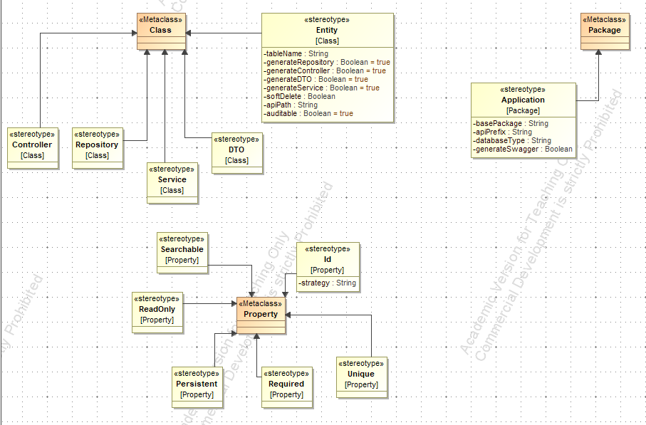

# UML to Spring Boot Code Generator

A Java-based code generation tool that reads UML models (using Eclipse UML2 and EMF libraries), validates them against domain-specific OCL rules, and automatically generates a fully structured, production-ready Spring Boot backend application using the FreeMarker template engine.
Writing boilerplate CRUD applications is repetitive and time-consuming. This project automates the entire backend generation process.

## ✨ Key Features

- **UML Profile & Stereotypes**: Custom MagicDraw profile extending standard metaclasses across three levels (Package, Class, Attribute) to inject domain-specific metadata.

  

- **OCL Model Validation**: Automated pre-generation validation ensuring model integrity (e.g., verifying that every entity has a defined primary key and non-empty table name).
- **Dual-Layer Protection Mechanism**: Generates **Base classes** (fully automated CRUD logic, JPA annotations, REST endpoints, overwritten on every run) and **Skeleton classes** (extends Base classes, safely preserved if manually modified by developers).
- **FreeMarker Templating**: Dynamically produces a standard Maven project structure, complete with `pom.xml` (Spring Data JPA, PostgreSQL, Swagger/OpenAPI), entities, repositories, services, controllers, and DTOs.
